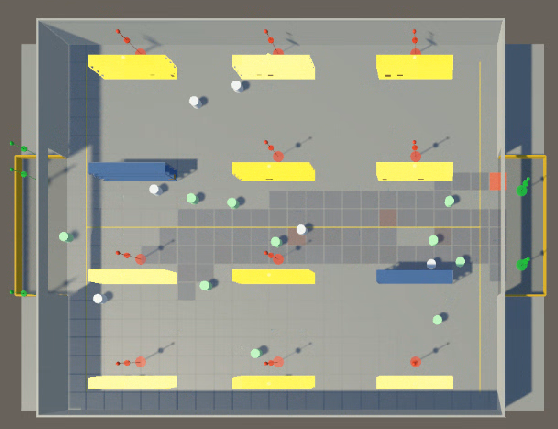

# ML-Warehouse

**複数のロボットが荷物を運ぶ倉庫をUnityで再現し、動きを学習・評価できるプロジェクトです。**

ロボットは入口から指定された棚へ荷物を運び、出口へ戻ります。倉庫の形やロボットの台数を変えながら、センサーの情報を使った動きと、複数台が同時に走るときの接触を確認できます。

使用技術: Unity 2022.3 / C# / Unity ML-Agents（PPOによる行動の学習）/ Python（[tr.py](tr.py)で学習を連続実行し、学習済みモデルを保存）

## 作ったもの

| 機能 | できること | 実装 |
| --- | --- | --- |
| 倉庫の生成 | 棚や出入口の配置を設定から作り、異なる倉庫条件を試せます。 | [倉庫生成](Assets/Scripts/Warehousegenerator.cs)、[環境設定](Assets/Scripts/WarehouseEnvironmentPreset.cs) |
| ロボットの制御 | 前方の障害物や他のロボットとの距離・動きを観測し、移動と旋回を学習します。 | [ロボット](Assets/Scripts/WarehouseRobotAgent.cs)、[センサー](Assets/Scripts/WarehouseObservations.cs) |
| 通行履歴の共有 | ロボットが通った位置に数値を残し、時間とともに薄くなる地図を作ります。周囲の値を各ロボットが読める仕組みで、これを「フェロモン」と呼んでいます。 | [フェロモン](Assets/Scripts/WarehousePheromone.cs) |
| 学習と評価 | Pythonで複数回の学習を自動実行します。実験設定を記録し、学習済みモデルをテストして搬送数や接触数をCSVに出力します。 | [連続学習](tr.py)、[実験設定](Assets/Scripts/WarehouseExperimentConfig.cs)、[テストランナー](Assets/Scripts/WarehouseModelTestRunner.cs) |

## 動作評価の一例

前方センサーを改良して学習し直したモデルでは、同じ倉庫でロボット16台を300秒動かしたとき、**搬送完了数が平均307.5回から385.5回に増え、ロボット同士の接触が587.3回から155.9回に減りました**。それぞれ15回のテストの平均です。両モデルで倉庫や通行履歴の共有方法をそろえ、前方センサーを変更した比較です。[実験条件と詳しい結果](docs/experiments/front_dynamic_sensor_v4.md)

## 動かし方

1. **Unity 2022.3.62f3** でプロジェクトを開きます。使用したバージョンは[ProjectVersion.txt](ProjectSettings/ProjectVersion.txt)で確認できます。
2. [Packages/manifest.json](Packages/manifest.json) の ML-Agents は開発用PCの `C:/Packages/ml-agents/` を参照しています。別のPCでは、自分の環境にある互換パッケージの場所へ参照先を変更してください。
3. 学習する場合は [`Assets/Scenes/ml Training.unity`](Assets/Scenes/ml%20Training.unity)、学習済みモデルを動かす場合は [`Assets/Scenes/ml test.unity`](Assets/Scenes/ml%20test.unity) を開きます。学習にはPythonの `mlagents-learn` も必要です。設定と操作の詳細は[学習・テスト手順](EXPERIMENT_WORKFLOW.md)を参照してください。

## 関連資料

- [研究状況](RESEARCH_STATUS.md): 実装済み事項、結果、未検証の問い。
- [前方観測の比較](docs/experiments/front_dynamic_sensor_v4.md): 上記の結果の条件、試行別の値、限界。
- [フェロモン3方式の比較](docs/experiments/pheromone_mode_front_dynamic_v1.md): 比較条件とseed別の値。
- [学習・推論テスト手順](EXPERIMENT_WORKFLOW.md): Unity Editorでの設定、学習、ONNX評価。

実験の生ログと評価CSVはGit管理外の `results/` に保存します。主要な数値とrun IDは各実験記録に残しています。
